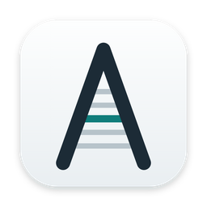
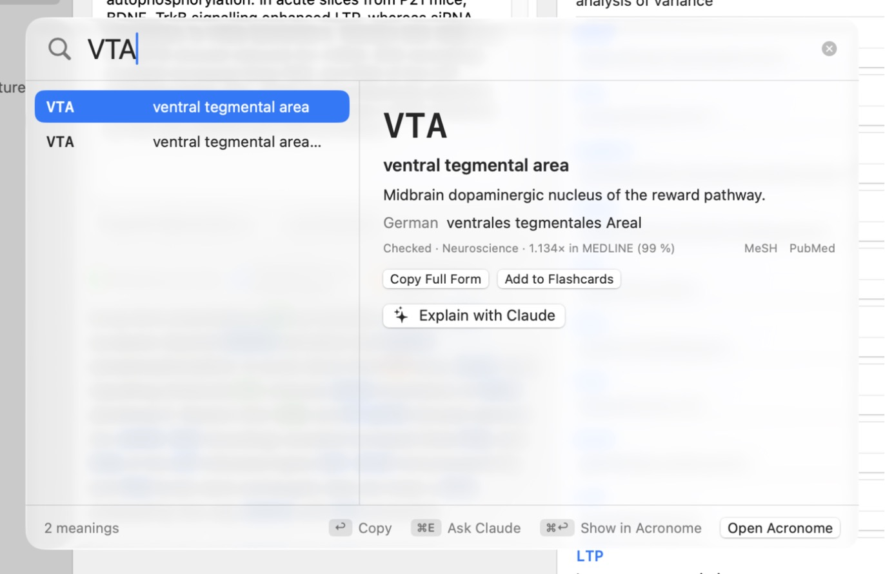
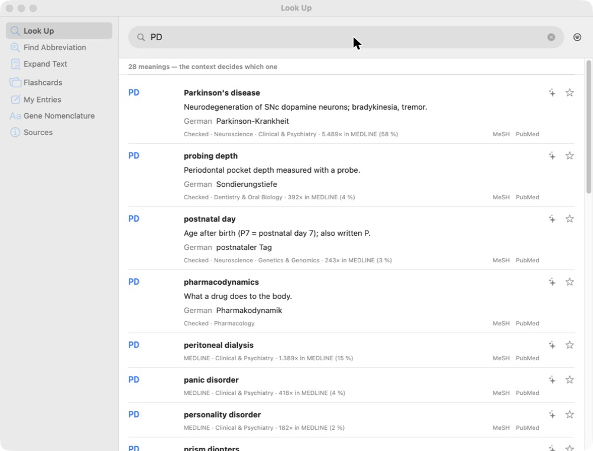
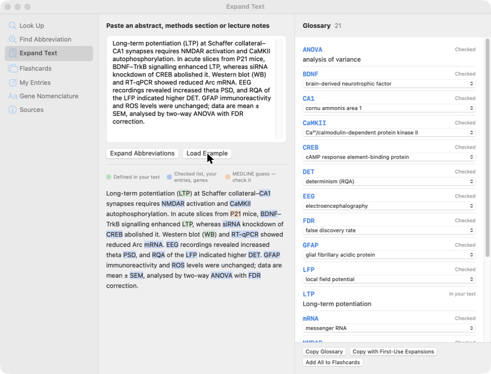

<p align="center">
  
</p>

<h1 align="center">Acronome</h1>

<p align="center"><b>The abbreviations of the life sciences, one shortcut away.</b><br>
A native macOS app for students and researchers who keep running into <i>LTP</i>, <i>NMDAR</i>, <i>RT-qPCR</i> and <i>PD</i> (all 28 meanings of it) while reading papers.</p>

<p align="center">
  
  
  
</p>

<p align="center"></p>

## Why

Biomedical papers are dense with abbreviations, and many are ambiguous: *PD* is Parkinson's disease to a neurologist, probing depth to a dentist and postnatal day to a developmental biologist. General dictionaries don't know them, and searching each one breaks your reading. Acronome answers in the place you're already working, ranks the meanings by how often each is used in the literature, and tells you which ones are checked and which are guesses.

## Features

- **Quick panel from anywhere.** Press **⌃⌥Space**, type or paste an abbreviation, and press **↩** to copy its full form. If you've just copied the abbreviation, it is looked up straight away. The panel can be resized, and it remembers its size and position.
- **Every meaning, ranked.** About 62,000 entries from three layers (below), each labelled by source. The MEDLINE count shows how common each meaning is.
- **Expand Text.** Paste an abstract or a methods section and every abbreviation is highlighted. Meanings the text defines itself, such as "long-term potentiation (LTP)", are found automatically, and the others are chosen from context. You can export a glossary, or the text with each abbreviation spelled out at first use (APA style).
- **Term → abbreviation**, in English or German ("Blut-Hirn-Schranke" → BBB).
- **Explain with Claude** *(optional)*: a short, referenced note on any meaning. **Ask Claude** suggests meanings for abbreviations that aren't in the database, and you can save them.
- **Flashcards** with spaced repetition (Leitner boxes), **your own entries**, and a **gene nomenclature** helper (human *BDNF* vs. mouse *Bdnf*, HGVS notation).
- Native SwiftUI/AppKit following Apple's Human Interface Guidelines: system controls, light and dark mode, and Liquid Glass on macOS 26 and later.

<p align="center"> </p>

## Install

Acronome is distributed as source. It builds in about a minute and has no third-party dependencies.

**Requirements:** macOS 14 or later; Xcode or the Command Line Tools (`xcode-select --install`); Python 3 (included with the Command Line Tools).

```bash
git clone https://github.com/hadiazraq/acronome.git
cd acronome
./build.sh --install
```

`build.sh` does four things:
1. Downloads and builds the MEDLINE abbreviation layer (one time, see [Data](#data)).
2. Compiles a release build.
3. Signs it locally (ad hoc).
4. Copies `Acronome.app` to `~/Applications`, then opens it.

Builds made on your own Mac open without Gatekeeper warnings.

| Option | Effect |
|---|---|
| `./build.sh` | Build only, to `build/Acronome.app` |
| `./build.sh --no-medline` | Skip the MEDLINE layer: about 28,000 entries instead of 62,000 |
| `BUNDLE_ID=com.you.acronome ./build.sh` | Use your own bundle identifier |
| `swift run` | Run from source during development |

## Use

| Where | Keys |
|---|---|
| Anywhere | **⌃⌥Space** opens the quick panel (choose another shortcut in Settings) |
| Quick panel | ↑↓ choose · ↩ copy the full form · ⌘E ask Claude · ⌘↩ show in the main window · ⌘O open Acronome · Esc close |
| Main window | ⌘0 opens it · ⇧⌘L opens the quick panel · ⌘↩ expands the text in Expand Text |
| Flashcards | Space shows the answer · 1–4 grade it |

The menu-bar icon and **Settings** (⌘,) cover the shortcut, automatic clipboard lookup, open at login and the Claude connection.

## Claude (optional)

Acronome works fully offline without it. To turn on **Explain with Claude** and **Ask Claude**, open **Settings → Claude** and choose a connection:

- **Claude Code**, using your Claude plan. Install [Claude Code](https://docs.claude.com/en/docs/claude-code) and log in once by running `claude` in Terminal. Acronome calls it in print mode with tools, MCP servers and settings disabled.
- **Anthropic API key.** Paste a key from the [Claude Console](https://console.anthropic.com). It is stored in your macOS Keychain and sent only to `api.anthropic.com`.

Press **Test Connection** to check it works. Claude is called only when you click or press ⌘E.

> **⚠️ Claude's answers are generated, not checked.** Acronome labels them "not verified". Check facts against primary sources, and open every reference and DOI before you cite it. Explanations are stored on your Mac in `~/Library/Application Support/Acronome/ai-notes.json`.

## Data

| Layer | Entries | Source and licence | In this repo? |
|---|---|---|---|
| Hand-checked | 558 (333 with German terms) | Written for Acronome: molecular and cell biology, genetics, neuroscience, immunology, methods, imaging and electrophysiology, statistics, pharmacology, physiology, dentistry. MIT | ✅ `Resources/data/core.json` |
| Human genes | 27,065 | [HGNC](https://www.genenames.org) approved symbols with aliases. CC0 | ✅ `Resources/data/hgnc.json` |
| MEDLINE | ~34,600 | [ADAM](https://doi.org/10.1093/bioinformatics/btl480): abbreviation–meaning pairs mined from MEDLINE abstracts (2006 baseline), defined at least 10 times. **GPL** | ❌ built locally by `scripts/fetch_data.py` |

The MEDLINE layer is GPL-licensed, so it is **not redistributed here**. `scripts/fetch_data.py` downloads it from the [Medical Abbreviation and Acronym Meta-Inventory](https://github.com/lisavirginia/clinical-abbreviations), pinned to one commit and checked against a SHA-256 hash, and converts it on your machine. Its field tags (Neuroscience, Immunology …) are keyword guesses, and they are labelled as such in the app.

Refresh the gene layer with `python3 scripts/fetch_data.py --hgnc`.

**Known gaps.** ADAM ends in 2006, so many newer method names are missing (single-cell, spatial transcriptomics and much of the CRISPR toolbox). Add them as your own entries, use Ask Claude, or contribute them to the hand-checked list.

## How it works

| File | Role |
|---|---|
| `App.swift` | App entry, shared state, menu bar, Settings |
| `HotKey.swift` | Global shortcut via Carbon `RegisterEventHotKey`; no Accessibility permission needed |
| `QuickPanel.swift` | Non-activating floating `NSPanel`, so typing works without leaving your current app |
| `Library.swift` | Loading, indexing, normalisation and search. `TNF-α`, `TNFa` and `tnf alpha` all match; spelling variants of one meaning are merged |
| `Expander.swift` | Expand Text: the Schwartz & Hearst (2003) algorithm for in-text definitions, then context-based disambiguation |
| `Claude.swift` | Optional Claude integration (Claude Code CLI or Messages API), prompts and views |
| `UserStore.swift` | Your entries, flashcards and history, stored in `~/Library/Application Support/Acronome/` |

**Ranking:** hand-checked and your own entries come first, then human genes, then MEDLINE meanings by frequency. The frequency shows how common a meaning is, not which one your paper means; the context decides that.

## Contributing

Issues and pull requests are welcome, especially **additions to the hand-checked list**. In `Resources/data/core.json`, each row is `[abbreviation, full form, [field codes], one-line definition, German term]`. Field codes: `mol gen cell neuro imm micro pharm phys meth img stat clin dent eco chem`. Please cite a source in the pull request for anything non-obvious.

## Credits and references

Created by **Hadi Azraq**. Released under the [MIT License](LICENSE). Third-party data keeps its own licence (see [LICENSE](LICENSE)).

- Grossman Liu, L., Grossman, R. H., Mitchell, E. G., Weng, C., Natarajan, K., Hripcsak, G., & Vawdrey, D. K. (2021). A deep database of medical abbreviations and acronyms for natural language processing. *Scientific Data, 8*, Article 149. https://doi.org/10.1038/s41597-021-00929-4
- Schwartz, A. S., & Hearst, M. A. (2003). A simple algorithm for identifying abbreviation definitions in biomedical text. *Pacific Symposium on Biocomputing, 8*, 451–462. https://doi.org/10.1142/9789812776303_0042
- Seal, R. L., Braschi, B., Gray, K., Jones, T. E. M., Tweedie, S., Haim-Vilmovsky, L., & Bruford, E. A. (2023). Genenames.org: The HGNC resources in 2023. *Nucleic Acids Research, 51*(D1), D1003–D1009. https://doi.org/10.1093/nar/gkac888
- Zhou, W., Torvik, V. I., & Smalheiser, N. R. (2006). ADAM: Another database of abbreviations in MEDLINE. *Bioinformatics, 22*(22), 2813–2818. https://doi.org/10.1093/bioinformatics/btl480

Acronome is an independent project and is not affiliated with Anthropic, HGNC or the NLM.
